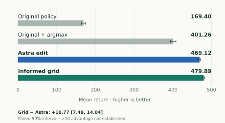
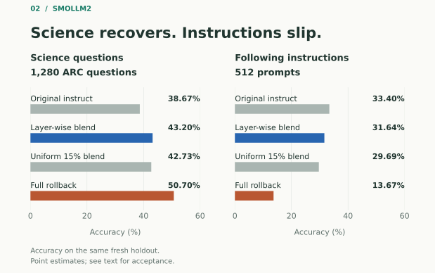

A public CartPole policy scored **164.60** out of a possible 500 in a reserved evaluation. After an edit to a small set of parameters, it scored **465.14**. The network had not been retrained. GPT-6 Astra had proposed changing how strongly it responded to pole angle and how sharply it chose actions. The candidate passed all six of the experiment's checks: improvement in return and near-completion, and preservation of 200-step survival, evaluated separately for left- and right-tilted starts. [[1]](#ref-1)

That is a promising result for an LLM acting as an optimizer. But it leaves two questions open. Could a simpler method do as well? And when an edit helps one behavior, what happens to the others?

Those questions became the thread connecting our AutoWeight experiments across vision, control, and language. AutoWeight is the toolkit used to apply and evaluate the proposed changes. [[10]](#ref-10) Some edits worked for reasons we can explain mathematically. Others improved the target while damaging another behavior. One unchanged candidate failed a test and later passed a larger, fresh one. Understanding those differences turned out to be more useful than counting successes.

The broader motivation comes from *Sparks of Weight-Space Programming*, which investigates LLMs reading and writing neural-network weights, including demonstrations without environment feedback. Our experiments usually supplied architecture information, development results, or trajectories. They examine a related, narrower question: **can an LLM help propose useful weight changes when we can measure both the improvement and its cost?** [[2]](#ref-2)

## A promising edit meets a harder test

CartPole asks a policy to keep a pole balanced by moving a cart left or right. Each surviving step earns reward, up to a 500-step limit. The public [policy used here](https://huggingface.co/NithirojTripatarasit/ppo-CartPole-v1) already had useful behavior, but its original stochastic action selection left substantial room for improvement.

Astra's accepted edit changed two controls. It multiplied the first actor layer's pole-angle input column by **12**, increasing its response to that input. It then multiplied the output weights and bias by **3**, sharpening the action probabilities. In exact arithmetic, these operations are equivalent to scaling one input feature and scaling the output logits around the unchanged network.

The first reserved test showed a large gain. A follow-up then compared the edit with six alternatives on **1,024 new shared seeds**. This new cohort is why the original-policy mean below is 169.40 rather than 164.60. [[1]](#ref-1)

<a class="research-figure" href="/images/auto-weight-research/cartpole-controls.svg" aria-label="Open full-size figure"><picture><source media="(max-width: 600px)" srcset="/images/auto-weight-research/cartpole-controls-mobile.svg"></picture></a>

*Figure 1. The improvement survives, but its interpretation changes. Four main comparisons on 1,024 fresh shared seeds. Bars show mean return; whiskers are descriptive 95% bootstrap intervals. The three additional controls are reported in the text. Source: our archived control experiment. [[1]](#ref-1)*

Simply choosing the original policy's highest-probability action—*argmax*—raised its mean to **401.26**. Angle scaling alone reached **402.73**, while output scaling alone reached **256.30**. The combined Astra edit still did better, at **469.12**. Those ablations support contributions from both parts of the edit. The seventh policy, the Astra edit with argmax actions, scored **487.80** descriptively; it was outside the prespecified superiority comparisons.

Then the numerical control changed the story. An eight-point grid, informed by the earlier successful edit, selected angle gain **12** and output gain **6**. Its mean was **479.89**. The grid's advantage over the Astra candidate was **10.77**, with a simultaneous two-sided 99% interval of **[7.49, 14.04]**. The direction favors the grid; an advantage larger than the prespecified 10-return margin is not established.

This was not an independent contest to discover the right edit from scratch. The grid inherited a useful parameterization and range from the earlier result. Both searches tried eight candidates on 128 episodes each, with the same maximum candidate-step budget, but their actual work differed: **308,555 versus 362,308 simulator steps**. The comparison supports the resulting numerical policy, while leaving the value of Astra's diagnosis unresolved.

There was another useful control. An equivalent inference wrapper and the edited weights produced the same sampled actions at **1,485 visited parity states**, with small floating-point logit differences. The weight edit packages the intervention into a checkpoint; it does not add a function unavailable to that wrapper.

The lesson is specific: **the edit improved this policy substantially, but improvement over the original did not establish an advantage for LLM optimization over an informed numerical alternative.**

## Why some targeted edits work

The clearest success came from a problem that needed very little structural change: an image classifier was too confident.

The public [ResNet18 classifier](https://huggingface.co/edadaltocg/resnet18_cifar10) kept choosing the same classes after we divided its final-layer weights and bias by a positive temperature. Mathematically, logits change from *z* to *z/T*. Their ranking stays the same, but the probability distribution becomes less concentrated when *T* is greater than one. This is established temperature scaling. [[3]](#ref-3)

A 301-point grid selected **T = 1.82938** using development data. On **1,000 reserved CIFAR-10.1 images**, accuracy remained **89.9%**, while mean confidence fell from **96.09% to 89.77%**. Negative log-likelihood—a score that penalizes confident mistakes—fell from **0.423800 to 0.332648**, a **21.5% reduction**. The NLL-improvement lower bound was **0.052818**, above the required 0.01. [[1]](#ref-1)

CIFAR-10.1 supplies naturally collected images for testing generalization beyond the original CIFAR-10 test set; the measured overconfidence of this particular checkpoint comes from our experiment. [[4]](#ref-4) The successful intervention adjusted confidence without needing to learn a new class distinction. It improved probability quality, not recognition accuracy. It also serves as a conventional numerical positive control, rather than evidence for a uniquely LLM-discovered repair.

The [continuous MountainCar policy](https://huggingface.co/sb3/ppo-MountainCarContinuous-v0) had a different opportunity. It already reached the goal reliably, but reaching the goal consumed control effort. For a successful episode, reward is **100 minus the accumulated quadratic action cost**.

Astra inspected trajectories and motivated two adjustable quantities: motor-mean gain and normalized-velocity gain. A frozen 16-point numerical search chose **0.74178** and **1.45283**. On **1,024 fresh seeds**, both the original and edited policies completed every episode. The edited mean return rose from **93.9295 to 96.2973**, so its **+2.36785** gain directly corresponds to lower control cost on those episodes. Average completion time also fell slightly, from **299.88 to 295.15 steps**. [[1]](#ref-1)

The candidate beat a fixed output-gain 0.8 control by **1.49825** return, with a one-sided 99% lower bound of **1.18368**. It also passed the completion-time and introduced-failure requirements. This establishes an efficiency improvement. A separately optimized one-dimensional gain search was not tested, and the edit has an equivalent input/output wrapper.

These two examples explain what a useful targeted edit can look like: **adjust an existing behavior through a control whose effect is understandable**. One changes confidence; the other changes control cost while retaining completion. CartPole's ablations support a similar account involving sensitivity and action selection.

**Table 1. Accepted outcomes on reserved data.** Discrete MountainCar is a separately registered retest; we return to its original failure below. Source: experiment records. [[1]](#ref-1)

| Case | Reserved evaluation | Original → edited | Decision |
|---|---|---|---|
| ResNet18 on CIFAR-10.1 | 1,000 images | NLL **0.423800 → 0.332648**; accuracy **89.9% → 89.9%** | All three gates pass |
| CartPole | 256 episodes | Mean return **164.60 → 465.14** | All six gates pass |
| Discrete MountainCar retest | 1,024 episodes per start group | Target return **−119.43 → −110.49**; preservation **−108.31 → −107.15** | Both gates pass |
| Continuous MountainCar | 1,024 default-reset seeds | Mean return **93.9295 → 96.2973**; both policies succeed **1,024/1,024** times | Native and stronger external gates pass |

*Tables scroll horizontally on small screens. Figures have a separate mobile layout and open at full size when selected.*

## Recovering one skill can cost another

A useful control knob is not always available. For a language model, the behavior we want to recover may be mixed with adaptations we want to keep.

We compared **SmolLM2-360M-Instruct** with its public base checkpoint. The target was science-question accuracy; the behavior to preserve was structural instruction compliance. Blending toward the base reverses a fraction of the fine-tuning update. Earlier work on model soups and task arithmetic shows that combining parameters can be useful under particular designs. Our repair search tests its own model pair and objectives. [[5]](#ref-5) [[6]](#ref-6)

Astra tried six selective tensor masks, then five uniform blend strengths from 15% to 35%, and finally six layer-wise schedules. The final selected schedule moved successive eight-layer blocks **30%, 20%, 10%, and 0%** toward the base, with **15%** for nonlayer tensors. It passed development on **2,560 ARC questions and 768 instruction prompts**. Earlier exposed holdouts had been explicitly moved into development; the final evaluation used new examples.

On that fresh evaluation, full rollback answered the most science questions correctly—and followed the fewest instructions. The selected layer blend offered a less costly compromise. [[1]](#ref-1)

<a class="research-figure" href="/images/auto-weight-research/smollm2-gates.svg" aria-label="Open full-size figure"><picture><source media="(max-width: 600px)" srcset="/images/auto-weight-research/smollm2-gates-mobile.svg"></picture></a>

*Figure 2. Higher and farther right is better. Moving toward rollback improves science accuracy while sacrificing instruction compliance. Each point uses the same fresh holdout: 1,280 questions and 512 prompts. These are point estimates; preservation was not established for any edit under the frozen gates. Source: final SmolLM2 comparison. [[1]](#ref-1)*

**Table 2. The counts behind the tradeoff.** ARC uses 1,280 questions; instruction compliance uses 512 prompts. Source: final SmolLM2 comparison. [[1]](#ref-1)

| Checkpoint | ARC correct | Instruction passes | Both fixed gates pass? |
|---|---:|---:|---|
| Original instruct | 495 / 1,280 (**38.67%**) | 171 / 512 (**33.40%**) | Reference |
| Selected layer blend | 553 / 1,280 (**43.20%**) | 162 / 512 (**31.64%**) | **No** |
| Uniform 15% blend | 547 / 1,280 (**42.73%**) | 152 / 512 (**29.69%**) | No |
| Full rollback | 649 / 1,280 (**50.70%**) | 70 / 512 (**13.67%**) | No |

The layer blend answered **six more ARC questions** and passed **ten more instruction prompts** than the uniform 15% blend. These are descriptive advantages; superiority over that control was not established. Against the original instruct checkpoint, the layer blend gained **4.53 percentage points** on ARC and lost **1.76 points** on instruction compliance.

This pattern is consistent with a simple explanation: reversing part of a fine-tuning update can reverse useful adaptation along with the behavior associated with the regression. It does not prove that the two capabilities occupy inseparable circuits. Six layer schedules are a narrow search through possible interventions.

LunarLander supplied a more direct example of damage elsewhere. A vertical-velocity sensitivity edit improved its target cohort by **13.43 return**, while right/down starts lost **16.66 return** and **9.38 percentage points of success**. The candidate was rejected on development data. Shared input sensitivity and nonlinear rollout dynamics are plausible explanations; the experiment establishes the subgroup tradeoff, not a circuit-level mechanism. [[1]](#ref-1)

These cases show why a target score cannot carry the whole argument. The intervention changes a shared model, and the benefit may not be shared by every task or starting condition.

## A failed test does not always mean a harmful edit

The SmolLM2 result contains a subtlety. Its observed instruction loss was smaller than the five-point tolerance, but its uncertainty extended just beyond it.

AutoWeight's *preservation gate* required the lower confidence bound on the instruction-score change to be at least **−5 percentage points**. The selected blend's bound was **−5.0048828125**. It therefore failed confirmation, and no repair checkpoint was accepted. The frozen procedure was not rerun to seek a pass. [[1]](#ref-1)

The five-point tolerance was an experimental acceptance margin, not a validated deployment standard. Relative to the original **33.40%** instruction pass rate, it permits a loss of about **15%** of that rate. Whether that loss is acceptable depends on the application; passing this gate would not by itself establish deployment suitability.

That **0.0048828-point** shortfall is a decision under a finite-bootstrap rule, not a sharp scientific boundary between a harmless and harmful edit. The requirement was not established with the available evidence.

Discrete MountainCar makes the distinction easier to see. Its candidate multiplied **64 velocity-input weights by 0.95**. On the first reserved test, target improvement passed. The preservation group's average return was slightly better too: **+0.055**. But its lower bound, **−2.424**, missed the permitted **−2** margin.

A separately registered retest kept **the identical candidate bytes and thresholds** and used **1,024 fresh episodes per group**, instead of 128. Its preservation mean was **+1.160**, with a lower bound of **+0.333**. Both gates passed. [[1]](#ref-1)

The original failure remains part of the record. The larger test provides stronger evidence, but both sample precision and the observed mean changed. It does not tell us that every rejected edit would pass with more data.

It does tell us to distinguish **observed damage** from **failure to establish preservation**. LunarLander illustrates the first. MountainCar illustrates why the second can occur even when the point estimate is positive. Calling both simply “weight editing failed” would discard the most useful information.

## What this tells us about LLMs as optimizers

The initial CartPole result survives this examination: the edit really did improve the measured policy. What changes is the claim we can attach to it.

Astra proposed edits and useful ways to parameterize them. Numerical search sometimes chose the strengths. AutoWeight applied the resulting tensors and checked improvement and preservation on reserved data. Those are distinct contributions. Our **LLM-guided weight optimization** experiments do not isolate an end-to-end LLM optimizer against an equally informed alternative in every case.

We distinguish an **observed outcome**, a **functional explanation** of the changed computation, and a **proposed mechanism** for the resulting behavior. The strongest explanations for success concern what the edits compute. Positive temperature rescales confidence without changing class order. Input and output gains change sensitivities and action selection. In continuous MountainCar, higher successful-episode reward directly means lower action cost. The discrete MountainCar gain corresponds to about **8.94 fewer target steps per episode** on its retest, but why the particular velocity gain works internally remains open.

The explanations for failure are less uniform. We observed target/preservation tradeoffs, candidates too weak to meet the required gain, and confidence bounds too wide to establish a margin. We also tested restricted edit families. None of those findings establishes that weight editing generally fails or that LLMs cannot reason usefully about weights.

## Conclusion and our perspective

**Yes, weight-space programming can improve an existing model on held-out tests. These experiments do not establish that an LLM is a better optimizer than a well-informed numerical method.** Both statements matter: the gains are real, and the stronger baselines limit what we can claim about how they were found.

Our interpretation is that the clearest opportunity is **finding a useful, testable control within an existing model**. Calibration has a mathematical explanation: positive temperature changes confidence without changing class order. The policy experiments show that input sensitivity and action selection can offer useful controls. In continuous MountainCar, the measured reward gain means less control effort while completing every tested episode. These cases support targeted adjustment; they do not demonstrate the creation of a missing capability.

The negative results tell a different story in each case. SmolLM2 recovered science accuracy while losing instruction compliance; LunarLander improved one starting cohort while damaging another. Other candidates simply did not establish the required improvement or preservation margin. The MountainCar retest shows why a rejection is not automatically evidence of harm. We can explain the measured tradeoffs and the acceptance decisions, but we have not established a neural mechanism that makes those failures inevitable.

**Our current view is that an LLM is most promising here as a proposer of interventions and experiments.** Astra suggested useful edits and parameterizations; numerical search sometimes selected their strengths. The informed CartPole grid then outperformed the earlier Astra candidate on the fresh comparison. Because that grid inherited the earlier insight, this result neither measures the independent value of Astra's diagnosis nor establishes an LLM optimization advantage. A fair discovery comparison would need matched information and budgets from the start.

For AutoWeight, we therefore see the strongest demonstrated value in making a proposed repair earn acceptance: select on development data, preserve a fresh test, measure the behavior at risk, and compare with rollback or a simple alternative. That is our interpretation of this collection, not a general ranking of optimization methods. A small set of heterogeneous cases cannot settle that ranking.

We started with a strikingly better CartPole score. We end with a more useful standard: **a better checkpoint is one result; evidence that we found a better way to repair models is another.** The successes show that weight edits can be worth trying. The failures and controls show what must be measured before trusting them.

## Methods and remaining results

AutoWeight freezes a checkpoint, development examples, reserved confirmation examples, and acceptance requirements. Proposals are scored on development data; a selected eligible candidate can then spend its confirmation test. Vision and policies use custom evaluators that load named arrays; SmolLM2 uses native Hugging Face checkpoints. The target models were not retrained during these edit searches. [[10]](#ref-10)

The collection covers **one image-classification case, eight RL environments, and four language-model cases**, represented by 14 external runs/cohorts and three related SmolLM2 studies. No fault was injected into these public checkpoints. Most RL cases are performance shortfalls, rather than documented historical regressions. Follow-ups are related experiments, and cases have different objectives and budgets; a pooled success rate would be misleading. All reported measurements are from the archived experiments. [[1]](#ref-1)

**Table 3. Rejected outcomes across the collection.** Development failures left their reserved confirmation sets unused. A positive mean alone does not satisfy a confidence-bound requirement. [[1]](#ref-1)

| Case and stage | Observed evidence | What failed |
|---|---|---|
| Pendulum · development | Eight candidates rejected; best target mean gain **+2.91**, lower bound **−0.06**, required **+5** | Target improvement not established |
| Acrobot · development | Twelve candidates rejected; best target mean gain **+0.57**, lower bound **−1.87**, required **+3** | No eligible candidate in the bounded search |
| BipedalWalker · development | A candidate gains **+13.90** reward; improvement in the fraction of episodes scoring ≥300 has lower bound **+6.25 pp**, required **+10 pp** | Reward alone does not satisfy the joint objective |
| LunarLander · development | Velocity scaling gains **+13.43** target return but loses **16.66** return and **9.38 pp** success on right/down starts | Observed subgroup damage |
| LunarLanderContinuous · development | Selected candidate gains **+15.09** return; lower bound **+3.94**, required **+5** | Required target margin not established |
| Discrete MountainCar · original confirmation | Preservation mean **+0.055**; lower bound **−2.424**, required **−2** | Preservation not established |
| SmolLM2 layer blend · fresh confirmation | ARC **+4.53 pp**; instruction **−1.76 pp**; instruction lower bound **−5.0049 pp**, required **−5 pp** | Preservation narrowly fails |

**Table 4. Exploratory language-model pilots.** These metrics are narrower than the public failure reports that motivated them. None produced an accepted repair. [[1]](#ref-1)

| Pilot | Recorded development outcome | Interpretive limit |
|---|---|---|
| Qwen2-0.5B biology | Best first-token Yes/No accuracy **62.5%**, below an **80%** floor; four of six allowed attempts recorded | Incomplete search; short authored judgments do not measure full explanations |
| Qwen3-0.6B chronology | Four attempts; best **56.25%**, unchanged from baseline | The original always answers True, so 56.25% is also the majority-label baseline |
| SmolLM-135M science/sentiment | Six attempts, including one unscored incompatible-donor error; best science accuracy **29.69%**, below a **50%** floor | First-token scoring is sensitive to answer format; no confirmation |

**Selection and retesting.** The first two SmolLM2 rounds had no eligible candidate; their held-out comparisons were diagnostic. The layer round selected one development-eligible candidate before fresh scoring. Exposed examples became development data in later rounds. The MountainCar retest was separately registered after failure, with no new weight search. There is no joint error guarantee across this collection of searches and retests.

**Uncertainty.** Native gates generally used 4,096 paired bootstrap draws, a 0.05 family level, and per-run metric correction. SmolLM2's primary decision used two gates; secondary simultaneous control analyses are separate. CartPole's five prespecified contrasts used 50,000 draws and simultaneous two-sided 99% intervals. Continuous MountainCar added stronger external one-sided 99% bounds and an exact introduced-failure bound. Bootstrap coverage is approximate. Figures use archived statistics, with no new inference or resampling.

**Language data and scoring.** ARC is a science-question benchmark. [[7]](#ref-7) The final holdout uses unused questions from its official **train splits**, because earlier rounds nearly exhausted the Challenge test split. They were held out from repair selection, not guaranteed absent from upstream training. Instruction scoring uses verifiable constraints from the IFEval approach, [[8]](#ref-8) applied to **512 unused Ai2 prompts** with the same 17 supported Google strict checkers. These are not the original IFEval prompt set. [[9]](#ref-9) Source mixtures differ across rounds, so absolute scores are not one learning curve.

ARC uses zero-shot continuation ranking; the instruction metric measures structural compliance, not general answer quality. Rollback uses the common instruct tokenizer/chat interface. One legacy development checker had a seeded random-letter fallback; a separate exclusion sensitivity did not change selection. No fresh-holdout checker consumed random state. Infrastructure errors, such as incompatible donor tokenizers, are separate from scored model failures.

**Scope and software.** RL conclusions apply to the recorded simulator versions and reset distributions. External vision/RL runs used released AutoWeight 0.5.0; later SmolLM2 runs included the documented native-HF extension. The integration checked 172 content-hashed records, frozen dataset/evaluator identities, and five accepted export hashes representing four case families. This was an artifact-consistency audit, not an independent rerun of all models.

### Experiment records and provenance

This is the public, readable index for reference [1]. It identifies the archived studies behind the results and links to their summaries in this article. **The underlying run files are retained in the author's archive and are not publicly released here.** This index is a summary of those records, not an independently reproducible raw-data release. The AutoWeight GitHub link in reference [10] identifies the software separately.

- **CartPole — initial confirmation and stronger controls.** Archive identifiers: `real-rl-cartpole/RESULTS.md` and `real-rl-cartpole/comparison-20261107/analysis.json`. The first evaluates one selected edit on 256 reserved episodes; the second compares seven policies on 1,024 fresh shared seeds. [Results, controls, and Figure 1](#a-promising-edit-meets-a-harder-test).
- **ResNet18 calibration.** Archive identifier: `real-ml/README.md`, backed by its frozen issue and confirmation report. Temperature is selected on 1,000 development images and evaluated on 1,000 reserved images. [Calibration explanation and Table 1](#why-some-targeted-edits-work).
- **Continuous MountainCar.** Archive identifier: `real-rl-mountaincarcontinuous/RESULTS.md`. A 16-point search precedes the 1,024-seed comparison with the original and a fixed scalar control. [Efficiency result and its limitations](#why-some-targeted-edits-work).
- **SmolLM2 recovery and preservation.** Archive identifiers: `public-smollm2-layer-blend/protocol.json`, `selection.json`, and `toolkit-confirmation.json` within that study. The selected layer blend and controls share the final 1,280-question, 512-prompt holdout. [Exact counts and Figure 2](#recovering-one-skill-can-cost-another); [acceptance decision](#a-failed-test-does-not-always-mean-a-harmful-edit). The earlier selective and uniform studies remain separate diagnostic evaluations.
- **Discrete MountainCar — rejection and retest.** Archive identifiers: `real-rl-mountaincar/RESULTS.md` and `real-rl-mountaincar/retest/RESULTS.md`. The first uses 128 episodes per group; the separately registered retest uses 1,024 new episodes per group with identical candidate bytes and thresholds. [Both outcomes and their interpretation](#a-failed-test-does-not-always-mean-a-harmful-edit).
- **Remaining negative results and pilots.** The integrated `catalogue.json` and `gate-results.csv` retain 377 extracted gate rows, with development, confirmation, and diagnostic comparisons distinguished. [Tables 3–4 and evaluation methods](#methods-and-remaining-results) summarize the remaining cases, including searches that never advanced to confirmation.

## References

1. **Xavier, M. (2026).** [AutoWeight experiment records: study index and provenance](#experiment-records-and-provenance). Public summary of the author's archived runs, evaluation reports, and analyses, 7 November 2026. Underlying run artifacts are unpublished; this is the source record for the reported experiments, not an independent study.

2. **Takehi, R., Teoh, J., Zhang, A., and Khattab, O. (2026).** [Sparks of Weight-Space Programming: LLMs can natively read & write neural network weights](https://rikiyat.github.io/blog/weight-space-programming/). Research blog, 2 November 2026.

3. **Guo, C., Pleiss, G., Sun, Y., and Weinberger, K. Q. (2017).** [On Calibration of Modern Neural Networks](https://arxiv.org/abs/1706.04599). ICML 2017.

4. **Recht, B., Roelofs, R., Schmidt, L., and Shankar, V. (2019).** [Do ImageNet Classifiers Generalize to ImageNet?](https://proceedings.mlr.press/v97/recht19a.html). ICML 2019, PMLR 97, 5389–5400. Introduces new test sets for both CIFAR-10 and ImageNet.

5. **Wortsman, M., et al. (2022).** [Model soups: averaging weights of multiple fine-tuned models improves accuracy without increasing inference time](https://arxiv.org/abs/2203.05482). ICML 2022.

6. **Ilharco, G., et al. (2023).** [Editing Models with Task Arithmetic](https://arxiv.org/abs/2212.04089). ICLR 2023.

7. **Clark, P., et al. (2018).** [Think you have Solved Question Answering? Try ARC, the AI2 Reasoning Challenge](https://arxiv.org/abs/1803.05457). arXiv:1803.05457.

8. **Zhou, J., et al. (2023).** [Instruction-Following Evaluation for Large Language Models](https://arxiv.org/abs/2311.07911). arXiv:2311.07911.

9. **Allen Institute for AI.** [IF_multi_constraints_upto5](https://huggingface.co/datasets/allenai/IF_multi_constraints_upto5). Dataset; evaluated revision `2e3a77407b7fce69f95b248d64a884e3ae1c2423`. Source of the fresh instruction prompts, used with the supported strict checkers.

10. **Xavier, M. (2026).** [AutoWeight](https://github.com/midhunxavier/auto-weight). Software for proposing, evaluating, and confirming model-weight edits. GitHub repository; repository access required.
