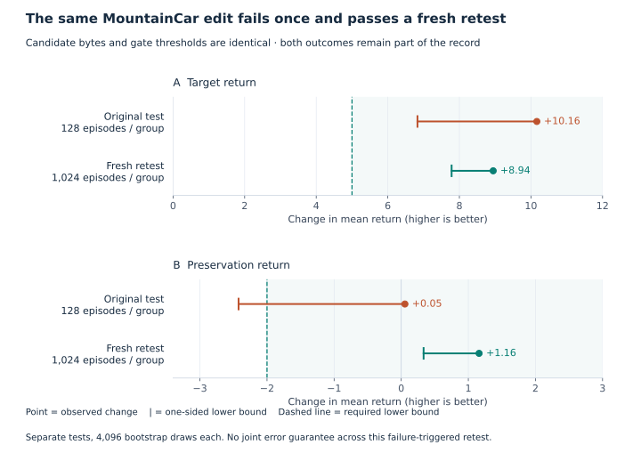

A small change to a checkpoint can produce a large improvement. In one public CartPole policy, an edit raised mean return from 164.60 to 465.14 on reserved evaluation episodes. In a public image classifier, scaling its final layer reduced negative log-likelihood by 21.5% without changing accuracy. These are useful results. They also invite a harder question: **what made the edit work, and what would a simpler alternative have achieved?**

I used AutoWeight to investigate public models across vision, reinforcement learning, and language. The collection includes successful edits, rejected searches, a failure followed by a successful fixed-candidate retest, and an instruction-tuned language model whose science recovery did not establish preservation. The strongest explanation for success is often a small, interpretable adjustment to a behavior the model already has. Failure has several meanings: an observed tradeoff, an insufficient gain, or insufficient evidence to certify a margin.

The result is a mixed picture. **Direct edits can improve models. A better score alone does not establish a successful repair, a new mechanism, or an advantage for an LLM over numerical tuning.**

## What we tested

AutoWeight separates proposal from acceptance. A run freezes a checkpoint, development examples, reserved confirmation examples, and explicit improvement and preservation requirements. A proposer supplies changes to named tensors; the runner applies and scores them. An eligible candidate can be selected on development data and checked on confirmation. An accepted export must satisfy the frozen requirements.

The experiments use accessible checkpoint weights, rather than API-only models. Vision and policy networks run through custom evaluators that load their named arrays; the SmolLM2 studies use native Hugging Face checkpoints. GPT-6 Astra authored the SmolLM2 edits and contributed policy diagnoses and proposals. Other candidates were selected by numerical grids or a fixed Sobol search. This is a collection of workflows, not a benchmark of one uniform agent algorithm.

The scope is **one image-classification case, eight RL environments, and four language-model cases**, represented by 14 external runs/cohorts and three related SmolLM2 studies. Follow-ups are not independent cases. Most RL targets are performance shortfalls in existing policies; the SmolLM2 base/instruct comparison addresses a loss associated with instruction tuning. No fault was injected into these public checkpoints. Cases, metrics, and search budgets differ, so an overall success percentage would be misleading.

A *gate* here means a declared acceptance rule. Typically, the lower confidence bound on a paired score change must exceed an improvement margin or a tolerated preservation loss. Passing means those measured requirements were met. Failing does not automatically mean the edit made the model worse.

## When weight edits succeeded

*On a phone, scroll tables horizontally. Open any figure to view it at full size.*

**Table 1. Accepted outcomes on reserved data.** These are different tasks with different units. Discrete MountainCar is a separately registered retest; its original failure is retained below.

| Case | Reserved evaluation | Original → edited | Decision |
|---|---|---|---|
| ResNet18 on CIFAR-10.1 | 1,000 images | NLL **0.423800 → 0.332648**; accuracy **89.9% → 89.9%** | All three gates pass |
| CartPole | 256 episodes | Mean return **164.60 → 465.14** | All six gates pass |
| Discrete MountainCar retest | 1,024 episodes per start group | Target return **−119.43 → −110.49**; preservation **−108.31 → −107.15** | Both gates pass |
| Continuous MountainCar | 1,024 default-reset seeds | Mean return **93.9295 → 96.2973**; both policies succeed **1,024/1,024** times | Native and stronger external gates pass |

### Calibration worked because confidence was adjustable without changing the decision

The public [ResNet18 classifier](https://huggingface.co/edadaltocg/resnet18_cifar10) was overconfident on the evaluated CIFAR-10.1 images. A 301-point development-only grid selected a temperature of **1.82938**. Dividing the final layer's weights and bias by that positive number changes its logits from *z* to *z/T*. Class rankings remain the same in exact arithmetic, while the probabilities become less concentrated.

On confirmation, mean confidence fell from **96.09% to 89.77%**, alongside **89.9% accuracy**. NLL fell by 21.5%, and the Brier score improved from 0.166720 to 0.152091. The NLL-improvement lower bound, **0.052818**, exceeded the required 0.01. This is direct evidence that confidence adjustment improved the scored probabilities while retaining decisions on the evaluated images.

The explanation is unusually clear: the edit corrects a confidence mismatch without needing to learn a new class distinction. It is standard [temperature scaling](https://arxiv.org/abs/1706.04599), encoded in weights. The same operation could be applied to logits during inference. Its success establishes calibration improvement, not better image recognition or a new calibration method.

### Policy gains worked where a few controls changed useful existing behavior

The accepted [CartPole policy](https://huggingface.co/NithirojTripatarasit/ppo-CartPole-v1) edit multiplied the first actor layer's pole-angle input column by **12**, then multiplied the output weights and bias by **3**. Those operations increase sensitivity to pole angle and sharpen the action distribution. They are equivalent, in exact arithmetic, to an input-feature gain and a logit gain around the unchanged network.

A fresh comparison helps explain the improvement. Keeping the original weights but choosing the highest-probability action increased mean return from **169.40 to 401.26**. Angle gain alone reached **402.73**; logit gain alone reached **256.30**. The combined edit reached **469.12**. The ablations support contributions from both feature scaling and action selection. They do not identify a unique internal circuit or establish a general theory of control.

The public [continuous MountainCar policy](https://huggingface.co/sb3/ppo-MountainCarContinuous-v0) provides a more explicit objective. On successful episodes, its reward is **100 minus the accumulated quadratic action cost**. Astra's trajectory inspection motivated two parameters: motor-mean gain and normalized-velocity gain. A frozen 16-point numerical search selected **0.74178** and **1.45283**. Both the original and edited policies completed every confirmation episode, so their **+2.36785** return difference corresponds directly to lower control cost on those episodes. Mean completion time also fell slightly, from **299.88 to 295.15 steps**.

The candidate beat a fixed output-gain 0.8 control by **1.49825** return, with a one-sided 99% lower bound of **1.18368**. It passed the completion-time cap and the introduced-failure requirement. This supports a useful efficiency adjustment within an already competent policy. It does not show that opposing the current velocity is always wasteful, or that the two-parameter search beats an independently optimized one-parameter search.

The discrete MountainCar retest supports a useful velocity-sensitivity adjustment too. Its reward is −1 per step, so the **+8.94** target return gain means about 8.94 fewer steps per episode. The evaluation establishes that outcome; it does not isolate why the particular gain 0.95 works internally. That mechanistic question remains open.

Across these successes, the supported pattern is a mismatch that a small number of interpretable controls can address. Calibration changes confidence; CartPole changes sensitivity and sampling; continuous MountainCar changes action cost while retaining completion. Whether the same pattern predicts success on other checkpoints remains untested.

## A successful edit still needs a strong baseline

The CartPole follow-up evaluated seven policies on **the same 1,024 fresh seeds**. Its original-policy score differs from Table 1 because this is a new cohort.

*Figure 1. CartPole controls. Bars are descriptive 95% bootstrap intervals for each mean. They are not the simultaneous paired intervals used for the superiority decisions. The edited argmax policy is a descriptive comparison, outside the prespecified superiority family.*

The accepted edit beat original argmax and each single-scalar ablation by more than the declared 10-return margin. However, an eight-point numerical grid selected gains **12 and 6** and scored **479.89**, higher than the earlier edit's **469.12**. The edit-minus-grid difference is **−10.77**, with a simultaneous two-sided 99% interval of **[−14.04, −7.49]**. This supports the direction of the grid's advantage, but does not establish an advantage greater than the prespecified 10-return margin.

The grid used the earlier discovery to choose its parameterization and ranges. Both searches evaluated eight candidates on 128 episodes each and had the same maximum candidate-step budget; realized candidate steps differed (**308,555 versus 362,308**). Consequently, this comparison tests the resulting policies, not independent discovery efficiency. An LLM may have contributed the useful search space even where numerical search found better values.

Native-weight and equivalent-wrapper execution also produced the same sampled actions at all **1,485 visited parity states**, with small floating-point discrepancies in logits. This establishes a compact way to store the policy change. It gives no expressive advantage over that equivalent wrapper. Deployment convenience could still matter, but it was not measured.

## When weight edits failed

**Table 2. Rejected outcomes and the reason for rejection.** Development failures did not consume their reserved confirmation sets. A lower bound is compared with its declared requirement, rather than treating a positive mean as sufficient.

| Case and stage | Observed evidence | What failed |
|---|---|---|
| Pendulum · development | Eight candidates rejected; best target mean gain **+2.91**, lower bound **−0.06**, required **+5** | Target improvement not established |
| Acrobot · development | Twelve candidates rejected; best target mean gain **+0.57**, lower bound **−1.87**, required **+3** | No eligible candidate in the bounded search |
| BipedalWalker · development | A candidate gains **+13.90** reward; improvement in the fraction of episodes scoring ≥300 has lower bound **+6.25 pp**, required **+10 pp** | Reward alone does not satisfy the joint objective |
| LunarLander · development | Velocity scaling gains **+13.43** target return but loses **16.66** return and **9.38 pp** success on right/down starts | Observed subgroup damage |
| LunarLanderContinuous · development | Selected candidate gains **+15.09** return; lower bound **+3.94**, required **+5** | Required target margin not established |
| Discrete MountainCar · original confirmation | Preservation mean **+0.055**; lower bound **−2.424**, required **−2** | Preservation not established |
| SmolLM2 layer blend · fresh confirmation | ARC **+4.53 pp**; instruction **−1.76 pp**; instruction lower bound **−5.0049 pp**, required **−5 pp** | Preservation narrowly fails |

### Some edits improved the target by damaging another behavior

LunarLander is the clearest observed tradeoff. Scaling vertical-velocity sensitivity improved the target cohort while worsening right/down starts. Those are measured effects in the development sample, and the candidate was rejected there. The result supports the practical explanation that one shared policy adjustment can help some states and hurt others. Nonlinear rollout dynamics and shared input sensitivity are plausible mechanisms, but no circuit-level mechanism was isolated.

SmolLM2 shows a related tension across tasks. We compared **SmolLM2-360M-Instruct** with its public base checkpoint, treating science-question accuracy as the recovery target and structural instruction compliance as the behavior to preserve. Astra first tried six selective tensor masks, then five uniform blends from 15% to 35%, and finally six layer-wise schedules. Earlier exposed holdouts were explicitly moved into development for later rounds; later confirmation used new examples.

The selected layer schedule moved successive eight-layer blocks **30%, 20%, 10%, and 0%** toward the base; nonlayer tensors used **15%**. It passed development on pooled **2,560 ARC questions and 768 instruction prompts**.

**Table 3. SmolLM2 on the final fresh holdout.** ARC uses 1,280 questions; instruction compliance uses 512 prompts. Counts are shown so the small differences between blends remain visible.

| Checkpoint | ARC correct | Instruction passes | Both fixed gates pass? |
|---|---:|---:|---|
| Original instruct | 495 / 1,280 (**38.67%**) | 171 / 512 (**33.40%**) | Reference |
| Selected layer blend | 553 / 1,280 (**43.20%**) | 162 / 512 (**31.64%**) | **No** |
| Uniform 15% blend | 547 / 1,280 (**42.73%**) | 152 / 512 (**29.69%**) | No |
| Full rollback | 649 / 1,280 (**50.70%**) | 70 / 512 (**13.67%**) | No |

*Figure 2. Recovery and preservation are different requirements. A circle shows the mean change; the cap at the left is the one-sided lower bound. The segment is not a two-sided confidence interval. Dashed lines show the +2-point ARC and −5-point instruction thresholds. Bounds use the archived two-metric comparison procedure; selected-versus-control superiority is not tested by this figure.*

Full rollback restores the most science accuracy and loses the most instruction compliance. Layer-wise blending offers a better observed compromise than the uniform 15% blend: **six additional ARC answers and ten additional instruction passes**. That small advantage is descriptive; statistical superiority over the blend was not established.

Why might blending produce this tension? A uniform blend reverses a fraction of the entire fine-tuning update. It can undo useful adaptation along with the behavior associated with the regression. The measured tradeoff is consistent with coupled effects along that direction. It does **not** prove that science knowledge and instruction following are inseparable in the network, or that a different edit family could not preserve both. Six layer schedules explore only a small subset of possible changes.

### Some candidates failed because the required evidence was missing

The SmolLM2 candidate's instruction score fell **1.7578 percentage points**. Its lower confidence bound was **−5.0048828125 points**, just below the permitted **−5**. The frozen decision is rejection; no checkpoint was accepted. The **0.0048828-point** shortfall is not a scientifically sharp boundary between a safe and harmful edit. It is the outcome of the prespecified finite-bootstrap procedure, which was not rerun to obtain a pass.

Discrete MountainCar makes the distinction clearer. The original candidate multiplied 64 velocity-input weights by **0.95**. On its first confirmation, target improvement passed and preservation had a slightly positive mean, but the preservation lower bound missed its margin. A separately registered retest kept the **identical candidate bytes and gates**, then evaluated 1,024 fresh episodes per group instead of 128. Both gates passed.

*Figure 3. The original failure and the larger fresh retest are separate results. Marks have the same meaning as Figure 2, now in return units. The retest was triggered by the first outcome; the stated error control applies within each test and does not provide a joint guarantee across the two tests.*

The larger test supplies stronger preservation evidence. It does not erase the original failure, and it does not show that every rejected candidate would pass with more data. Both sample precision and the observed mean changed. This is evidence against equating “failed a preservation gate” with “proved harmful.”

### Some searches were too limited to settle the broader question

Pendulum and Acrobot show that the tested scaling families and budgets did not find eligible improvements. BipedalWalker shows that a higher average reward can coexist with insufficient improvement in near-complete episodes. These are useful bounded negatives. They do not establish that all weight interventions would fail.

**Table 4. Exploratory language-model pilots.** These have narrower interpretations than the main confirmation studies.

| Pilot | Recorded development outcome | Interpretive limit |
|---|---|---|
| Qwen2-0.5B biology | Best first-token Yes/No accuracy **62.5%**, below an **80%** floor; four of six allowed attempts recorded | Incomplete search; short authored judgments do not measure full explanations |
| Qwen3-0.6B chronology | Four attempts; best **56.25%**, unchanged from baseline | The original always answers True, so 56.25% is also the majority-label baseline |
| SmolLM-135M science/sentiment | Six attempts, including one unscored incompatible-donor error; best science accuracy **29.69%**, below a **50%** floor | First-token scoring is sensitive to answer format; no confirmation |

These pilots found no accepted repair under their recorded metrics. They do not test every behavior in the public reports that motivated them. Infrastructure rejections, such as an incompatible tokenizer or tied-weight storage, are recorded separately from numerical edits that actually received model scores.

## What we can conclude about why

The evidence supports different levels of explanation. Algebra establishes what an intervention computes. Ablations test whether components contribute to the measured gain. Task scores establish an outcome on evaluated examples. None of those, alone, establishes a general neural mechanism.

**Table 5. Explanations supported by the experiments.**

| Pattern | Supported explanation | Remaining uncertainty |
|---|---|---|
| Calibration succeeds | Positive temperature rescales confidence while preserving class order; held-out probability scores improve | Transfer to other shifts and classifiers |
| Policy gains succeed | Input/output gains change useful existing control; ablations and parity tests support their functional role | Whether LLM diagnosis outperforms independent human or automatic discovery |
| Continuous control becomes more efficient | All held-out episodes complete; higher reward means lower quadratic control cost | Whether this is the best low-dimensional tuning method |
| Target gain damages another cohort | The same intervention has different measured effects across initial conditions | The precise internal or dynamical mechanism |
| Checkpoint reversal trades recovery for compliance | Moving toward the base recovers one measured capability and loses another | Whether those capabilities can be separated by a different edit |
| A positive estimate fails its gate | The confidence bound does not establish the required margin | Whether a larger independent sample would pass |
| A search finds no eligible edit | Its tested candidates and budget were insufficient | Whether a broader family or better diagnostic would succeed |

The useful distinction is between **improving the model**, **establishing preservation**, and **showing a method advantage**. AutoWeight made those decisions explicit in this collection. It did not make the proposer infallible, and a successful export did not make conventional calibration or policy tuning a new algorithm.

For practitioners, the clearest opportunity in these cases is an existing capability whose deployment behavior can be adjusted through a small, interpretable intervention. The clearest warning is that a target-only score can hide damage elsewhere. Both are reasons to test strong controls and preservation cohorts before calling a change a repair.

## Methods and limits that change the interpretation

**Selection and independence.** Candidates were chosen on development data under their per-study protocols. The first two SmolLM2 rounds had no eligible candidate; their held-out comparisons were diagnostic, not accepted confirmations. The final layer round selected one development-eligible candidate before fresh scoring. Reused examples were explicitly exposed development data. The MountainCar retest was separately registered after a failure, with no new weight search. There is no joint error guarantee over this entire collection of searches and retests.

**Uncertainty.** Native gates generally used 4,096 paired bootstrap draws, a 0.05 family level, and per-run metric correction. The SmolLM2 primary decision used two gates; secondary simultaneous control analyses are retained separately. CartPole's five prespecified contrasts used 50,000 draws and simultaneous two-sided 99% intervals. Continuous MountainCar also used stronger external one-sided 99% bounds and an exact introduced-failure bound. Bootstrap coverage is approximate. Figures reproduce recorded statistics; they do not add new model evaluations or rerun inference to change a decision.

**What the samples represent.** RL episodes measure the recorded simulator versions and reset distributions, not unseen physics or all states. The final ARC holdout uses unused questions from the official **train splits**, because earlier rounds nearly exhausted the Challenge test split. It is held out from repair selection, not guaranteed absent from upstream model training. The instruction set uses 512 unused Ai2 tasks scored with the same 17 supported strict Google checkers. Different source mixtures across rounds prevent interpreting absolute scores as one learning curve.

**What the metrics measure.** ARC uses zero-shot continuation ranking; instruction scoring measures structural compliance rather than general conversational quality. Rollback uses the common instruct tokenizer/chat interface. A legacy development checker had a seeded random-letter fallback; excluding that one case in a separate sensitivity analysis did not change selection. No fresh-holdout checker consumed random state. The record retains the original decision and the sensitivity analysis.

**Software and audit.** External vision/RL runs used released AutoWeight 0.5.0; later SmolLM2 runs included the documented native-HF extension. The integration checked 172 content-hashed records, frozen dataset/evaluator identities, and five accepted export hashes representing four case families. This is an artifact-consistency audit, not an independent rerun of all models. The public supplement provides the reported numbers, figure inputs, source hashes, and plotting code; it is not a complete model-and-runtime reproduction package.

## Relation to prior work

[Temperature scaling](https://arxiv.org/abs/1706.04599) explains the ResNet positive control. [Model soups](https://arxiv.org/abs/2203.05482) and [task arithmetic](https://arxiv.org/abs/2212.04089) establish that parameter combinations can work under their own designs. Our bounded searches neither reproduce nor refute those experiments.

[Sparks of Weight-Space Programming](https://rikiyat.github.io/blog/weight-space-programming/), by Rikiya Takehi, Jayden Teoh, Alex Zhang, and Omar Khattab, motivates the broader question of LLMs reading and writing weights. Its reported successes include settings without environment feedback. The present collection often provides architecture knowledge, trajectories, and development feedback; it does not isolate the same capability or claim an independent replication.

What this collection adds is an evidence-backed account of **when useful edits survived explicit tests, when they did not, and why those outcomes require different explanations**. The positive and negative results belong together: they show both the practical reach of simple interventions and the limits of treating a promising score as a completed repair.

## Data and figures

[Download the research supplement](https://midhunxavier.com/files/auto-weight-research-20261107.zip) for the full extracted gate table, CartPole comparison statistics, compact case catalogue, provenance hashes, and the script that generates all three figures. The figures are included as SVG, PNG, and PDF. The supplement distinguishes the source experiments from the later presentation work and includes the original rejected outcomes.

References: Guo et al., *On Calibration of Modern Neural Networks* (ICML 2017); Wortsman et al., *Model soups* (ICML 2022); Ilharco et al., *Editing Models with Task Arithmetic* (ICLR 2023); Takehi et al., *Sparks of Weight-Space Programming* (2 November 2026).
